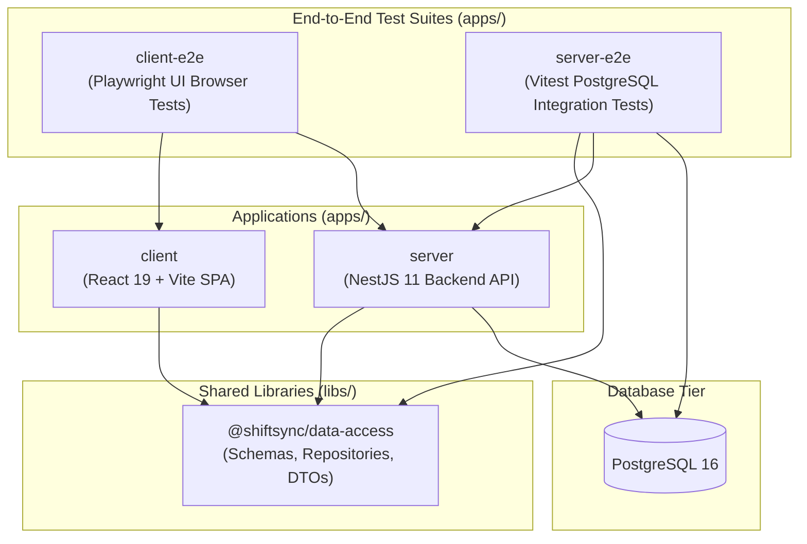
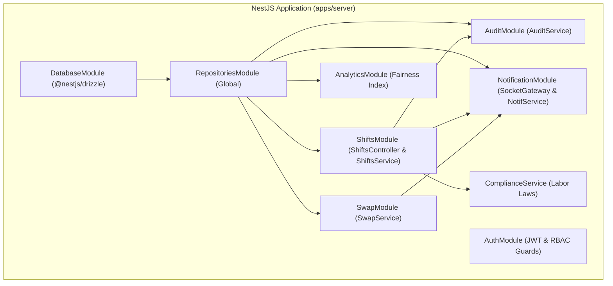

# System Architecture Overview

## 1. Monorepo Topology & Project Graph

ShiftSync is structured as an **Nx monorepo** providing unified tooling, shared type safety, computation caching, and coordinated release cycles across the entire full-stack platform.



### Workspace Projects

| Project                       | Type                | Tech Stack                                            | Role in System                                                     |
| :---------------------------- | :------------------ | :---------------------------------------------------- | :----------------------------------------------------------------- |
| **`apps/client`**             | SPA Application     | React 19, Vite, React Router v7, Tailwind CSS         | Manager dashboard, Staff portal, and Admin audit views             |
| **`apps/server`**             | Backend Application | NestJS 11, Socket.io, `@nestjs/drizzle`, Passport JWT | Core business logic, compliance engine, real-time gateway          |
| **`libs/shared/data-access`** | Shared Library      | Drizzle ORM, `class-validator`, PostgreSQL types      | Single source of truth for schemas, repositories, and API DTOs     |
| **`apps/server-e2e`**         | Test Suite          | Vitest, Axios, Docker PostgreSQL 16                   | Integration tests validating compliance and database transactions  |
| **`apps/client-e2e`**         | Test Suite          | Playwright, Chromium                                  | Browser journey tests validating user interactions and permissions |

---

## 2. Shared Data Access Layer (`@shiftsync/data-access`)

The shared data access library eliminates contract drift between the NestJS backend and the React frontend by consolidating all data models and communication contracts into a single package.

### 2.1 Entity Schemas & Type Inference

All PostgreSQL tables are defined using Drizzle ORM's `pgTable` builder in `src/lib/entities/`:

- `users`, `locations`, `skills` (Core entities)
- `user_locations`, `user_skills` (Many-to-many certifications)
- `manager_locations` (Location-based access control mapping)
- `availability` (Recurring windows and date-specific exceptions)
- `shifts`, `shift_assignments` (Scheduling entities with `headcountNeeded`)
- `swap_requests` (Peer-to-peer swaps and open marketplace drops)
- `notifications`, `audit_logs` (Real-time and compliance logs)

Types are inferred directly using Drizzle's `InferSelectModel` and `InferInsertModel`, ensuring strict compile-time type safety across the monorepo:

```typescript
export type Shift = InferSelectModel<typeof shifts>;
export type NewShift = InferInsertModel<typeof shifts>;
export type User = InferSelectModel<typeof users>;
```

### 2.2 Repository Pattern

Database access is encapsulated within domain repositories in `src/lib/repositories/`:

- `ShiftRepository`, `UserRepository`, `LocationRepository`
- `SwapRepository`, `NotificationRepository`, `AuditRepository`

Repositories inject `NodePgDatabase<typeof schema>` and utilize:

- **Drizzle Relational Queries (`db.query`)**: For nested, type-safe joins and eager loading (e.g., retrieving a shift with its assignments and user profiles).
- **Drizzle Standard Queries (`db.select`, `db.insert`, `db.update`)**: For targeted mutations and high-performance operations.

### 2.3 Universal Cursor-Based Pagination

All list collections implement cursor-based pagination via the shared `paginateWithCursor` helper:

```typescript
export interface CursorPaginationParams {
  cursor?: string; // Base64-encoded created_at + id
  limit?: number; // Default 10, max 50
}
```

This guarantees consistent $O(1)$ query performance and eliminates missing/duplicated items during concurrent schedule modifications.

---

## 3. Backend Application Architecture (`apps/server`)

The backend is built with **NestJS 11**, providing structured modularity and dependency injection.



### 3.1 Official Drizzle Integration (`@nestjs/drizzle`)

The server integrates with PostgreSQL using the official `@nestjs/drizzle` package. Configured in `DatabaseModule`, it provides the database instance through standard dependency injection using `getDrizzleToken()`.

### 3.2 Real-Time Gateway (`Socket.io`)

Real-time events are dispatched via `NotificationGateway`:

- Clients connect and join authenticated user and location rooms.
- Broadcasts dispatch `schedule:updated` and `swap:requested` events.
- Guarantees instant synchronization across multiple manager and staff screens without polling.

---

## 4. Frontend Application Architecture (`apps/client`)

The frontend is a **React 19 Single Page Application (SPA)** powered by **Vite** and **React Router v7**.

### 4.1 3-Tier Feature-Based Architecture

Modeled after _React Application Architecture for Production (2nd Edition)_, the client enforces a clean 3-tier unidirectional hierarchy:

```text
apps/client/src/
├── app/                  # Application Shell & Routing (Routes, Layouts)
│   ├── routes/           # Manager dashboard, Staff portal, Admin audit views
│   └── app.tsx           # Router configuration
├── features/             # Domain Modules (Self-contained)
│   ├── auth/             # Login, token management, role guards
│   ├── shifts/           # Calendar boards, shift modals, candidate suggestions
│   ├── swaps/            # Swap request modals, approval flows, drop cards
│   ├── staff/            # Staff directory, on-duty widget, availability
│   ├── analytics/        # Fairness Index charts, hours distribution
│   ├── audit/            # Audit history modals, corporate changelog
│   ├── notifications/    # Bell dropdown, unread badge counter
│   └── profile/          # User settings, notification preferences
├── components/           # Domain-Agnostic UI Primitives (Button, Modal, Card)
├── config/               # Centralized Zod environment configuration
└── lib/                  # Shared Axios client, Socket client, cn() utility
```

### 4.2 Architectural Boundary Enforcement (`eslint-import-rules.mjs`)

Strict ESLint boundary rules prevent architectural erosion:

- `components/`, `config/`, and `lib/` **cannot** import from `features/` or `app/`.
- `features/` **cannot** import from `app/`.
- Cross-feature dependencies follow a strict directed acyclic graph (DAG) (e.g., `shifts` may import `auth` and `audit`, but cannot import `swaps`).

### 4.3 Centralized Zod Environment Configuration (`src/config/env.ts`)

Client environment variables are never accessed raw via `import.meta.env`:

- Variables are validated at application boot using Zod (`z.string().url()`).
- Vite's `VITE_` prefix is stripped, exposing clean domain properties (`API_URL`, `SOCKET_URL`).
- Fails fast with human-readable error messages if required variables are missing.
