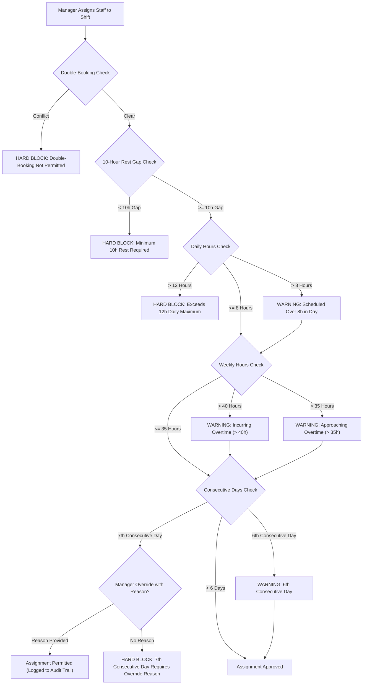

# Domain Rules & Labor Compliance

## 1. Overview of the Compliance Engine

In restaurant hospitality, staffing compliance is governed by strict labor regulations and collective bargaining standards. Non-compliance results in costly penalties, employee fatigue, elevated turnover, and legal exposure.

ShiftSync centralizes all labor law algorithms into a dedicated, injectable backend service: `ComplianceService` (`apps/server/src/app/shifts/compliance.service.ts`). The compliance engine executes synchronously during shift creation, staff assignment, and swap approval, distinguishing between **Hard Blocks** (actions that violate legal or physical constraints and are prevented entirely) and **Advisory Warnings** (actions that require managerial acknowledgement or documented justification).

---

## 2. Compliance Rules & Constraints Matrix

### 2.1 Double-Booking Prevention

- **Constraint Level**: **Hard Block**
- **Rule**: A staff member cannot be scheduled for two shifts whose time intervals overlap, even if the shifts are at different restaurant locations.
- **Evaluation**: Evaluated across all existing assignments where `startTime < candidateEnd AND endTime > candidateStart`.

### 2.2 Mandatory 10-Hour Rest Period

- **Constraint Level**: **Hard Block**
- **Rule**: Every staff member must receive at least **10 continuous hours of rest** between the end of one shift and the start of their next shift.
- **Operational Scenario**: Prevents "clopening" (closing the restaurant at 11:30 PM and opening the kitchen at 6:00 AM the following morning).
- **Evaluation**: The engine scans both previous and subsequent shifts within a 24-hour window:
  $$\Delta t_{\text{rest}} = \text{startTime}_{\text{current}} - \text{endTime}_{\text{previous}} \ge 10 \text{ hours}$$
  $$\Delta t_{\text{rest}} = \text{startTime}_{\text{next}} - \text{endTime}_{\text{current}} \ge 10 \text{ hours}$$

### 2.3 Daily Working Limits (8h & 12h)

- **Constraint Level**: **Warning (> 8h) / Hard Block (> 12h)**
- **Rule**:
  - Exceeding **8 hours** in a single calendar day issues an advisory warning indicating daily overtime exposure.
  - Exceeding **12 hours** in a single calendar day is a **hard block** to protect worker health and safety.
- **Calendar Boundary**: Evaluated against the 24-hour calendar day (`00:00:00` to `23:59:59`) calculated in the shift location's local timezone.

### 2.4 Weekly Overtime Tracking (35h & 40h)

- **Constraint Level**: **Proactive Warning (> 35h) / Overtime Alert (> 40h)**
- **Rule**:
  - When scheduled hours across the Monday-through-Sunday workweek exceed **35 hours**, the manager receives a proactive warning alerting them that the employee is approaching overtime.
  - When scheduled hours exceed **40 hours**, the assignment is flagged with an active Overtime alert, allowing payroll cost projections.

### 2.5 Consecutive Day Streaks & 7th Day Overrides

- **Constraint Level**: **Warning (6th Day) / Mandatory Override with Reason (7th Day)**
- **Rule**:
  - Staff scheduled for **6 consecutive calendar days** trigger an advisory warning.
  - Scheduling a staff member for a **7th consecutive calendar day** triggers a strict compliance block.
  - **Manager Override Mechanism**: A manager can override the 7th consecutive day restriction only by supplying an explicit, non-empty `overrideReason` (e.g., _"Emergency weekend banquet coverage agreed upon with employee"_). The override reason and manager identity are immutably recorded in the `audit_logs` table.

### 2.6 Overnight Shifts Across Midnight

- **Continuous Interval Math**: Shifts that cross midnight (e.g., Friday 10:00 PM to Saturday 3:30 AM) are treated as a single continuous block of work.
- **Rest Interval Calculation**: The rest gap calculation uses the actual shift `endTime` (3:30 AM on Saturday), meaning the staff member cannot be scheduled for any shift starting before 1:30 PM on Saturday (10 hours later).

---

## 3. Shift Swap & Drop State Machine

ShiftSync enforces a structured lifecycle for peer-to-peer shift swaps and marketplace drops:

| State       | Description                                                                     | Permitted Next States                          |
| :---------- | :------------------------------------------------------------------------------ | :--------------------------------------------- |
| `PENDING`   | Shift swap initiated by Staff A with target Staff B, or dropped to marketplace. | `ACCEPTED`, `REJECTED`, `CANCELLED`, `EXPIRED` |
| `ACCEPTED`  | Staff B has agreed to take the shift; pending manager approval.                 | `APPROVED`, `REJECTED`, `CANCELLED`            |
| `APPROVED`  | Location manager has approved the swap; shift assignment transferred.           | Terminal State                                 |
| `REJECTED`  | Peer declined the swap, or manager denied the transfer.                         | Terminal State (Original assignment preserved) |
| `CANCELLED` | Staff A cancelled the request, or shift details were edited by manager.         | Terminal State (Original assignment preserved) |
| `EXPIRED`   | Unclaimed marketplace drop reached the 24-hour cutoff before shift start.       | Terminal State (Original assignment preserved) |

### 3.1 The 24-Hour Drop Expiration Rule

When an employee places a shift up for grabs in the open shift pool without a designated peer, the drop request remains open until **24 hours prior to `shift.startTime`**. If no qualified colleague claims the shift before this window, the system automatically transitions the request to `EXPIRED`, leaving the original staff member responsible for the shift and preventing unexpected game-day absences.

### 3.2 The Regret / Shift Mutation Logic

If a location manager edits a shift's critical operational attributes (`startTime`, `endTime`, `locationId`, or `skillRequired`) while a swap or drop request is in `PENDING` or `ACCEPTED` status, the system **automatically cancels all active swap requests** associated with that shift. This guarantees that neither peer is trapped in a swap agreement based on outdated shift parameters.

### 3.3 Active Request Cap

To prevent marketplace clutter and speculative swapping, each employee is restricted to a maximum of **3 active pending requests** (combined total of outgoing swap requests and open drop requests).

---

## 4. Schedule Fairness Index

### 4.1 What Constitutes a "Premium Shift"?

In the hospitality industry, Friday and Saturday evening shifts generate the highest guest traffic and tip volumes. In ShiftSync, a shift is classified as **Premium** (`isPremium = true`) if:

1. The shift takes place on a **Friday** or **Saturday** (evaluated in the restaurant's local timezone).
2. The shift starts between **17:00:00** and **23:59:59** local store time.

### 4.2 The Normalized Fairness Index Formula (0–100)

The Fairness Index quantifies how equitably premium shifts are distributed among qualified peers sharing the same skill and location certification:

1. Let $P_i$ denote the number of premium shifts assigned to staff member $i \in \{1, 2, \dots, N\}$.
2. Calculate the mean ($\mu$) and standard deviation ($\sigma$) of premium shifts across all qualified peers:
   $$\mu = \frac{1}{N} \sum_{i=1}^N P_i, \quad \sigma = \sqrt{\frac{1}{N} \sum_{i=1}^N (P_i - \mu)^2}$$
3. Normalize into an index between 0 and 100:
   $$\text{Fairness Index} = \max\left(0, \min\left(100, 100 \times \left(1 - \frac{\sigma}{\max(1, \mu)}\right)\right)\right)$$

### 4.3 Interpretation Guidelines

- **Score 90–100 (Optimal Equity)**: Premium shifts are evenly distributed across the team.
- **Score 75–89 (Balanced)**: Acceptable variance due to part-time availability or temporary time-off.
- **Score < 70 (Inequitable)**: Disproportionate concentration of lucrative shifts; triggers an advisory badge on the Manager Analytics dashboard.

---

## 5. Core Operational Verification Scenarios

These 6 scenarios represent baseline real-world operational challenges that ShiftSync's architecture is explicitly verified against:

### 1. The Sunday Night Chaos

- **Context**: A bartender calls in sick two hours before an 8:00 PM Sunday shift at the Beach Grill.
- **Resolution**: The manager opens the Shift Details modal and triggers the Staff Suggestion engine. The engine filters all staff certified for Beach Grill with the "Bartender" skill, excludes anyone currently double-booked or in a rest gap violation, and ranks eligible staff by availability and weekly hours to enable rapid coverage.

### 2. The Overtime Trap

- **Context**: A manager attempts to assign a server who already worked 7.5 hours earlier in the day to a 5-hour dinner banquet.
- **Resolution**: Total daily hours would reach 12.5 hours. The compliance engine triggers a **Hard Block** (`> 12 hours daily limit`), halting the assignment and preventing severe labor standard violations.

### 3. The Timezone Tangle

- **Context**: A regional staff member based in Los Angeles (`America/Los_Angeles`) is temporarily scheduled to support the Uptown Lounge in New York (`America/New_York`).
- **Resolution**: All shift times are stored in UTC. When validating availability and rest periods, the system converts both the employee's personal availability windows and the shift's times into local venue time via `Intl.DateTimeFormat`, eliminating timezone mismatch errors.

### 4. The Simultaneous Assignment Race Condition

- **Context**: Two store managers at different branches attempt to assign the same high-performing server to concurrent shifts at the exact same moment.
- **Resolution**: Backend transactional constraints and double-booking checks guarantee that only the first committed transaction succeeds; the second request fails with a conflict error, preventing double-booking.

### 5. The Fairness Complaint

- **Context**: A server raises concerns that weekend shifts are consistently granted to a select few favorites.
- **Resolution**: The manager and corporate administrator review the Fairness Analytics dashboard. The system charts the exact 30-day premium shift distribution and displays the calculated Fairness Index, providing objective, indisputable data.

### 6. The Regret Swap

- **Context**: Staff A agrees to swap a 4:00 PM–10:00 PM shift with Staff B. While the swap is pending manager approval, the manager extends the shift to 4:00 PM–2:00 AM.
- **Resolution**: Because critical shift timing was modified, the system automatically revokes the pending swap request, restores the shift to Staff A, and notifies Staff B of the change.
