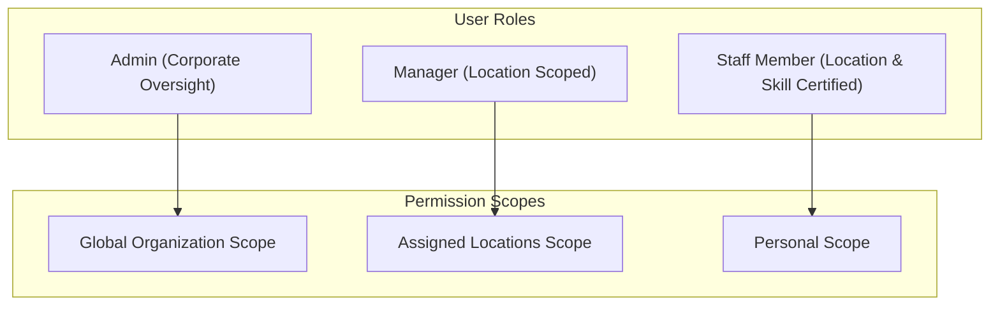
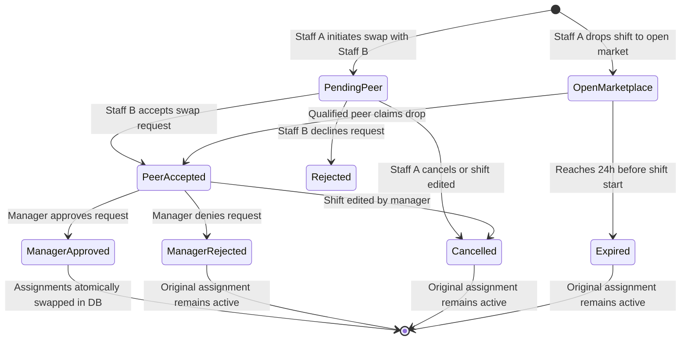

# Coastal Eats Product Requirements Specification

## 1. Executive Summary & Vision

**ShiftSync** is an enterprise workforce management and intelligent staff scheduling system tailored specifically for **Coastal Eats**, a multi-unit restaurant hospitality group. Coastal Eats operates dining establishments across contrasting metropolitan markets and geographic timezones, including:

- **Downtown Bistro** (New York, NY — `America/New_York`)
- **Uptown Lounge** (New York, NY — `America/New_York`)
- **Beach Grill** (Santa Monica, CA — `America/Los_Angeles`)
- **Bayview Tavern** (San Francisco, CA — `America/Los_Angeles`)

Restaurant scheduling is uniquely volatile: shift demand swings drastically based on weekends and reservations, staff frequently work across locations, overtime penalties accumulate quickly, and employee burnout or fairness complaints around desirable shifts ("premium weekend evenings") impact retention.

ShiftSync replaces ad-hoc spreadsheets and disconnected chat channels with a unified, compliance-driven, real-time platform that balances managerial control, staff autonomy, and legal compliance.

---

## 2. User Roles & Access Control (RBAC / LBAC)

ShiftSync implements a combination of **Role-Based Access Control (RBAC)** and **Location-Based Access Control (LBAC)**.

### 2.1 Corporate Administrator (`Admin`)

- **Global Visibility**: Unrestricted access across all restaurant locations, employees, schedules, and analytics.
- **Emergency Schedule Override**: Ability to edit, cancel, or unpublish shifts inside the 48-hour schedule lock window.
- **System Governance**: Full access to the corporate Immutable Audit Trail, configuration settings, and global user management.

### 2.2 Location Manager (`Manager`)

- **Location Scoping**: Explicitly assigned to one or more restaurant locations via `manager_locations`.
- **Schedule Management**: Create, edit, publish, and delete shifts for their assigned locations.
- **Shift Assignment**: Assign staff members who hold active certifications for the shift's location and required skill.
- **Swap & Drop Approval**: Review, approve, or reject peer-to-peer shift swaps and shift drop requests within their authorized locations.
- **Fairness & Compliance Monitoring**: View location-specific Fairness Index metrics, upcoming overtime warnings, and submit documented overrides for 7th consecutive day assignments.
- **Operational Boundaries**: Strictly barred from viewing or managing staff, shifts, or swaps at locations outside their assigned scope. Subject to the 48-hour schedule lock for published shifts.

### 2.3 Floor Staff Member (`Staff`)

- **Schedule Visibility**: View personal published shifts, assigned locations, and active colleagues on duty.
- **Availability Management**: Maintain recurring weekly availability windows (day of week, start time, end time) and submit date-specific unavailability exceptions.
- **Peer-to-Peer Swaps**: Initiate swap requests directly with certified peers who possess the required skill and location certifications.
- **Shift Drops**: Put unwanted shifts up for grabs into the open shift marketplace (up to 24 hours before shift start).
- **Request Cap**: Bound by an active limit of at most **3 pending requests** (swaps or drops) to prevent operational churn.
- **Real-Time Notification**: Receive instant notifications and unread badge alerts when shifts are published, swaps are accepted/approved, or schedule details change.

---

## 3. Shift Lifecycle & Scheduling Engine

### 3.1 Shift Data Model & Multi-Headcount

Each shift is tied to a specific location, start time, end time, and required skill. A single shift record supports `headcountNeeded >= 1`, allowing multiple qualified staff members to fulfill a single shift block (e.g., a Saturday evening needing 4 Servers) without duplicating shift entities.

### 3.2 Shift Publishing & The 48-Hour Lock

To protect workers from erratic last-minute schedule alterations while preserving emergency operational flexibility:

1. **Draft vs. Published**: Shifts start in `DRAFT` status and are invisible to staff until explicitly `PUBLISHED` by a manager.
2. **The 48-Hour Schedule Cutoff**:
   - Once the current time is within **48 hours** of a published shift's `startTime`, location managers are **locked** from editing start/end times, altering required skills, or unpublishing the shift.
   - Any emergency alteration inside 48 hours requires an **Admin override**, ensuring corporate accountability.
   - The UI displays explicit visual warnings as shifts approach the 48-hour cutoff.

### 3.3 Smart Staff Suggestion Engine

When a manager creates a shift or searches for replacement coverage:

1. **Filtering**: The engine evaluates all staff members and filters candidates against:
   - Location certification (`user_locations`)
   - Skill certification (`user_skills`)
   - Unavailability exceptions and recurring availability windows (`availability`)
   - Double-booking conflicts
   - Labor compliance caps (10-hour rest gap and 12-hour daily maximum)
2. **Ranked Candidate Presentation**: Eligible candidates are presented with transparent indicators showing projected weekly hours, overtime risk, and current fairness scores.

---

## 4. Labor Compliance & Overtime Governance

ShiftSync enforces federal, state, and hospitality labor standards directly inside the scheduling pipeline:

| Rule                        | Threshold                                  | System Action                        | Override Possible?                                 |
| :-------------------------- | :----------------------------------------- | :----------------------------------- | :------------------------------------------------- |
| **Double-Booking**          | Overlapping shift times                    | **Hard Block** (Prevents assignment) | No                                                 |
| **Mandatory Rest Period**   | `< 10 hours` between consecutive shifts    | **Hard Block** (Prevents assignment) | No                                                 |
| **Daily Working Cap**       | `> 12 hours` in a single calendar day      | **Hard Block** (Prevents assignment) | No                                                 |
| **Daily Advisory**          | `> 8 hours` scheduled in a single day      | **Advisory Warning**                 | Yes (Manager acknowledged)                         |
| **Weekly Overtime**         | `> 40 hours` across Monday–Sunday workweek | **Advisory Warning** & Overtime Flag | Yes (Overtime rates apply)                         |
| **Weekly Overtime Warning** | `> 35 hours` scheduled in workweek         | **Proactive Advisory Warning**       | Yes                                                |
| **6th Consecutive Day**     | 6 consecutive days with assigned shifts    | **Advisory Warning**                 | Yes                                                |
| **7th Consecutive Day**     | 7 consecutive days with assigned shifts    | **Compliance Override Required**     | Yes (Mandatory documented reason audited)          |
| **Overnight Shifts**        | Shifts spanning across midnight            | **Continuous Interval Math**         | Evaluated continuously against rest and daily caps |

---

## 5. Peer-to-Peer Shift Swaps & Open Drops

ShiftSync facilitates frictionless peer collaboration while giving management final approval authority:

### 5.1 Direct Peer Swaps

1. **Request Creation**: Staff A requests a direct swap with Staff B. Both must be certified for the location and skill.
2. **Peer Acceptance**: Staff B accepts or rejects the swap. The assignment remains with Staff A until managerial sign-off.
3. **Manager Approval**: The location manager receives a pending approval action. Approving atomically transfers the shift assignment in PostgreSQL and emits real-time WebSocket notifications.

### 5.2 Shift Drops & Expiration Guardrails

- **Open Drops**: Staff members who cannot work can drop their shift to the open location pool.
- **24-Hour Expiration Rule**: Unclaimed drop requests automatically expire **24 hours prior to shift start** to prevent unassigned shifts from hanging unresolved into game-day service.

### 5.3 Regret / Shift Mutation Logic

If a manager edits a shift's critical details (start time, end time, location, or skill) while a swap or drop request is pending, the system **automatically cancels all pending swap/drop requests** for that shift and notifies the participants, ensuring workers do not inherit unexpected schedule terms.

### 5.4 Anti-Churn Request Cap

Staff members cannot have more than **3 active pending requests** (swaps or drops) at any single time, preventing marketplace spam and schedule instability.

---

## 6. Schedule Fairness & Premium Shifts

Hospitality staff morale hinges on fair distribution of high-earning tip shifts ("Premium Shifts").

- **Definition of Premium Shift**: Any shift starting on **Friday or Saturday evening** between **17:00 and 23:59** local store time.
- **Fairness Index (0–100)**: A normalized equity metric calculated using the standard deviation of premium shifts assigned to staff within a role and location:
  - An index approaching **100** indicates perfect equitable distribution across qualified team members.
  - An index dropping below **70** signals high variance, alerting managers to preferential or uneven scheduling patterns.
- **Visual Analytics**: The Manager Dashboard renders a dedicated Fairness Analytics panel charting total hours worked, premium shift counts, and comparative equity scores.

---

## 7. Real-Time Collaboration & Notifications

- **Bidirectional WebSockets (Socket.io)**: Real-time event broadcasting for instant schedule updates without page reloads:
  - `schedule:updated`: Refreshes calendar boards when shifts are created, updated, published, or unpublished.
  - `swap:requested`, `swap:accepted`, `swap:approved`, `swap:rejected`: Pushes instant toasts and updates unread badge counts across staff and manager clients.
  - `audit:created`: Streams live audit records to the corporate oversight dashboard.
- **Live "On-Duty Now" Widget**: A real-time executive dashboard widget displaying current active staff, currently working locations, and scheduled end times.
- **Persistent Notification Center**: In-app dropdown recording all schedule interactions, with persistent unread badge counts synchronized across multiple active browser tabs.

---

## 8. Multi-Timezone Architecture

Coastal Eats operates across Eastern and Pacific time zones. To guarantee absolute temporal accuracy:

1. **UTC Storage**: All timestamps (`startTime`, `endTime`, `createdAt`, `updatedAt`) are stored strictly in UTC in PostgreSQL.
2. **Location Timezone Context**: Every restaurant record in `locations` defines its canonical IANA timezone (e.g., `America/New_York`, `America/Los_Angeles`).
3. **Timezone-Aware Calculations**: All availability checks, calendar day bounds, and overnight intervals are evaluated in the specific location's local timezone using standard `Intl.DateTimeFormat`.
4. **Local Display**: Staff and managers view shift times rendered in the restaurant's local operational time, preventing cross-country scheduling misinterpretations.

---

## 9. Immutable Audit Trail

For regulatory compliance, corporate oversight, and labor dispute resolution:

- **Immutable Log Table (`audit_logs`)**: Automatically captures:
  - `actorId` (User performing the modification)
  - `action` (`CREATE`, `UPDATE`, `DELETE`, `PUBLISH`, `ASSIGN`, `SWAP_APPROVE`, `OVERRIDE_7TH_DAY`)
  - `entityType` (`shift`, `assignment`, `swap_request`)
  - `entityId`
  - `timestamp` (UTC)
  - `diff` (JSON object containing exact before-and-after attribute states)
  - `reason` (Documented justification for manual overrides)
- **Shift History Modal**: Managers and Admins can open any shift on the schedule board to inspect its complete chronological changelog.
- **Corporate Audit View**: Admins can query, filter by date range/actor/action, and paginate across the entire corporate audit trail.
