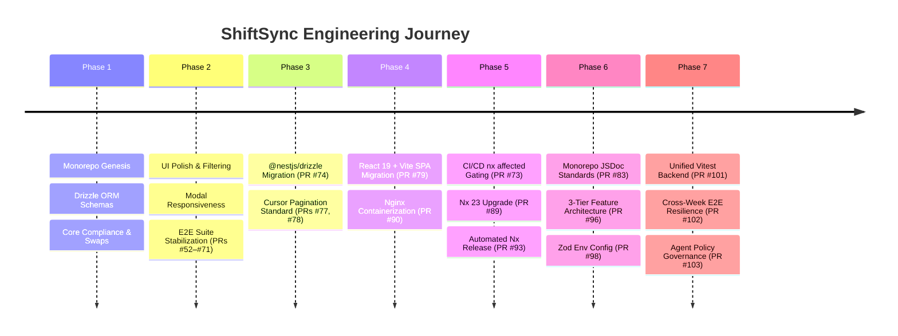

# ShiftSync Project History & Milestones

This document chronicles the major engineering milestones, architectural evolutions, and significant pull requests in the history of ShiftSync.

---

## 📅 Timeline Overview

---

## 🏛 Phase 1: Monorepo Genesis & Core Scheduling MVP

- **Nx Workspace Initialization**: Established the monorepo structure separating frontend, backend, and shared libraries.
- **Shared Data Access (`@shiftsync/data-access`)**: Built unified Drizzle ORM database schemas for users, locations, skills, availability, shifts, shift assignments, swap requests, notifications, and immutable audit logs.
- **Labor Law Engine**: Created `ComplianceService` enforcing double-booking prevention, 10-hour mandatory rest gaps, 8h/12h daily caps, 35h/40h weekly overtime rules, 7th consecutive day manager overrides, and continuous overnight shift calculations.
- **Swap & Drop State Machine**: Built `SwapService` providing peer-to-peer swap handshakes, 24-hour marketplace drop expiration, 3-request pending limits, and automatic swap cancellation on shift edits.
- **Real-Time WebSockets**: Integrated Socket.io for immediate schedule updates and notifications across connected clients.

---

## 🎨 Phase 2: UI Polish, Location Filtering & E2E Stabilization (PRs #52–#71)

- **PR [#52](https://github.com/JayKay24/ShiftSync/pull/52)–[#56](https://github.com/JayKay24/ShiftSync/pull/56)**: Enhanced schedule board rendering, weekly calendar navigation, and badge visualizations for premium shifts and labor law warnings.
- **PR [#57](https://github.com/JayKay24/ShiftSync/pull/57)–[#64](https://github.com/JayKay24/ShiftSync/pull/64)**: Refined Location-Based Access Control (LBAC) filters, preventing managers from accidentally viewing or modifying out-of-scope branch staff.
- **PR [#65](https://github.com/JayKay24/ShiftSync/pull/65)–[#71](https://github.com/JayKay24/ShiftSync/pull/71)**: Fixed modal viewport overflow bugs on mobile viewports, hardened Playwright E2E selectors, and introduced surgical database cleanup (`clearDynamicData()`) for stable, rapid integration test runs.

---

## ⚡ Phase 3: `@nestjs/drizzle` & Cursor-Based Pagination (PRs #74, #77, #78)

- **PR [#74](https://github.com/JayKay24/ShiftSync/pull/74)**: Migrated backend database injection from custom factory providers to the official `@nestjs/drizzle` module, registering database connections in a global `DatabaseModule` and domain repositories in a global `RepositoriesModule`.
- **PR [#77](https://github.com/JayKay24/ShiftSync/pull/77), [#78](https://github.com/JayKay24/ShiftSync/pull/78)**: Implemented universal **Cursor-Based Pagination** across all list endpoints (Shifts, Swaps, Staff, Notifications, Audit Logs) using Base64-encoded `createdAt` + `id` pointers. Replaced brittle offset pagination, eliminating missing/duplicate items during active scheduling and ensuring $O(1)$ database query performance.

---

## 🌐 Phase 4: React 19 + Vite SPA Migration & Containerization (PRs #79, #90)

- **PR [#79](https://github.com/JayKay24/ShiftSync/pull/79)**: Migrated frontend application from Next.js to a pure **React 19 SPA** powered by **Vite** and **React Router v7**. Eliminated SSR hydration friction and simplified client-side WebSocket lifecycle management.
- **PR [#90](https://github.com/JayKay24/ShiftSync/pull/90)**: Extracted production client Nginx configuration (`nginx.conf`) for containerized deployments, enabling lightweight Docker images with optimized asset caching and SPA history routing.

---

## 🚀 Phase 5: CI/CD Hardening, Nx 23 & Automated Releases (PRs #73, #82, #88, #89, #91, #93)

- **PR [#73](https://github.com/JayKay24/ShiftSync/pull/73), [#75](https://github.com/JayKay24/ShiftSync/pull/75)**: Implemented GitHub Actions CI pipeline with dependency caching, PostgreSQL service containers, and **`nx affected`** selective execution for `server-e2e` and `client-e2e`.
- **PR [#82](https://github.com/JayKay24/ShiftSync/pull/82), [#84](https://github.com/JayKay24/ShiftSync/pull/84)**: Integrated Husky pre-commit hooks and Commitlint enforcing Conventional Commits. Configured `body-max-line-length` $\le 100$ characters for clean git histories.
- **PR [#88](https://github.com/JayKay24/ShiftSync/pull/88), [#89](https://github.com/JayKay24/ShiftSync/pull/89)**: Upgraded monorepo to **Nx 23**, modernizing target configurations and plugin schemas.
- **PR [#91](https://github.com/JayKay24/ShiftSync/pull/91), [#93](https://github.com/JayKay24/ShiftSync/pull/93)**: Implemented automated **`nx release`** workflow (`.github/workflows/release.yml`) running on successful merges to `main`. Automatically parses commits, bumps semantic versions, updates `CHANGELOG.md`, and creates GitHub releases.

---

## 📐 Phase 6: JSDoc Standards, 3-Tier Architecture & Zod Config (PRs #83, #96, #98)

- **PR [#83](https://github.com/JayKay24/ShiftSync/pull/83)**: Standardized comprehensive JSDoc annotations across `@shiftsync/data-access`, `apps/server`, and `apps/client` with explicit `@param`, `@returns`, `@throws`, and compliance rule descriptions while preserving procedural comments.
- **PR [#96](https://github.com/JayKay24/ShiftSync/pull/96)**: Refactored `apps/client` into a strict **3-Tier Feature-Based Architecture** (`app` $\rightarrow$ `features` $\rightarrow$ `components`/`lib`/`config`) modeled on _React Application Architecture for Production (2nd Edition)_, enforced by custom ESLint boundaries (`eslint-import-rules.mjs`).
- **PR [#98](https://github.com/JayKay24/ShiftSync/pull/98)**: Replaced raw `import.meta.env` access with a centralized, Zod-validated environment configuration module (`src/config/env.ts`), removing Vite's `VITE_` prefix and failing fast on missing configuration.

---

## 🧪 Phase 7: Unified Vitest Backend, Calendar Resilience & Agent Policy (PRs #101–#103)

- **PR [#101](https://github.com/JayKay24/ShiftSync/pull/101)**: Migrated backend test suites (`apps/server`, `libs/shared/data-access`, `apps/server-e2e`) from Jest to **Vitest** with `unplugin-swc`. Unified testing tooling across the monorepo, significantly accelerating test startup and reducing memory footprint.
- **PR [#102](https://github.com/JayKay24/ShiftSync/pull/102)**: Resolved cross-week boundary test timing issues in `client-e2e` and enhanced `ManagerSchedule` with automatic cross-week calendar navigation when shifts are created outside the currently displayed Monday–Sunday week.
- **PR [#103](https://github.com/JayKay24/ShiftSync/pull/103)**: Installed agent skills suite in `.agents/skills/` and established strict execution policies in `AGENTS.md` governing deterministic, explicit skill invocation.
