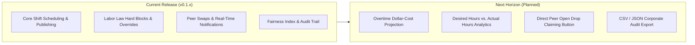

# Requirements Traceability Matrix & Product Roadmap

## 1. Traceability Overview

This document provides complete end-to-end traceability mapping Coastal Eats product requirements to implementation source files in the ShiftSync monorepo and their corresponding automated verification suites.

Status Definitions:

- **`Implemented`**: Fully built, integrated across backend and frontend, and verified with automated test suites.
- **`Partial`**: Core functionality and backend architecture implemented; extended UI controls or workflows scheduled.
- **`Planned`**: Fully specified in architecture; queued on the product roadmap.

---

## 2. Requirements Traceability Matrix

| Feature / Requirement             |    Status     | Backend Implementation                                                             | Frontend Implementation                                   | Automated Verification                                                    |
| :-------------------------------- | :-----------: | :--------------------------------------------------------------------------------- | :-------------------------------------------------------- | :------------------------------------------------------------------------ |
| **RBAC & LBAC Access Control**    | `Implemented` | `AuthModule`, `JwtAuthGuard`, `RolesGuard`, `LocationGuard`                        | `AuthContext`, `ProtectedRoute`, `RoleRedirect`           | `server-e2e/manager-access.spec.ts` `client-e2e/admin-manager.spec.ts` |
| **Shift Creation & Headcount**    | `Implemented` | `ShiftsService.createShift`, `ShiftRepository`                                     | `features/shifts/components/create-shift-modal.tsx`       | `server-e2e/scheduling.spec.ts` `client-e2e/scheduling.spec.ts`        |
| **48-Hour Schedule Cutoff Lock**  | `Implemented` | `ShiftsService.updateShift`, `ComplianceService.checkScheduleLock`                 | `features/shifts/components/shift-card.tsx` (Lock badge)  | `server-e2e/cutoff-constraints.spec.ts` `client-e2e/cutoff.spec.ts`    |
| **Admin Schedule Lock Bypass**    | `Implemented` | `ShiftsService.updateShift` (`user.role === 'ADMIN'`)                              | `features/shifts/components/edit-shift-modal.tsx`         | `server-e2e/cutoff-constraints.spec.ts` `client-e2e/admin.spec.ts`     |
| **Double-Booking Hard Block**     | `Implemented` | `ComplianceService.checkDoubleBooking`                                             | `features/shifts/components/assign-staff-modal.tsx`       | `server-e2e/scheduling.spec.ts`                                           |
| **10-Hour Mandatory Rest Period** | `Implemented` | `ComplianceService.checkRestPeriod`                                                | `features/shifts/components/assign-staff-modal.tsx`       | `server-e2e/scheduling.spec.ts` `client-e2e/compliance.spec.ts`        |
| **12-Hour Daily Cap Hard Block**  | `Implemented` | `ComplianceService.checkDailyLimits`                                               | `features/shifts/components/assign-staff-modal.tsx`       | `server-e2e/compliance.spec.ts`                                           |
| **8-Hour Daily Warning**          | `Implemented` | `ComplianceService.checkDailyLimits`                                               | Compliance Warning Badges                                 | `server-e2e/compliance.spec.ts`                                           |
| **35h/40h Weekly Overtime Rules** | `Implemented` | `ComplianceService.checkWeeklyLimits`                                              | Overtime Indicators on schedule board                     | `server-e2e/compliance.spec.ts`                                           |
| **7th Consecutive Day Override**  | `Implemented` | `ComplianceService.checkConsecutiveDays`, `overrideReason`                         | `features/shifts/components/override-modal.tsx`           | `server-e2e/compliance.spec.ts`                                           |
| **Overnight Shift Math**          | `Implemented` | `ComplianceService.calculateContinuousShiftHours`                                  | Schedule grid day rendering                               | `server-e2e/compliance.spec.ts`                                           |
| **Smart Staff Suggestion Engine** | `Implemented` | `ShiftsService.getEligibleStaffForShift`                                           | `features/shifts/components/candidate-suggestions.tsx`    | `server-e2e/scheduling.spec.ts`                                           |
| **Peer Shift Swap Workflow**      | `Implemented` | `SwapService.createSwapRequest`, `acceptSwap`, `approveSwap`                       | `features/swaps/components/swap-request-modal.tsx`        | `server-e2e/swap.spec.ts` `client-e2e/swaps.spec.ts`                   |
| **3-Request Active Cap**          | `Implemented` | `SwapService.checkActiveRequestLimit`                                              | Swap modal validation error                               | `server-e2e/edge-cases.spec.ts`                                           |
| **24-Hour Drop Expiration**       | `Implemented` | `SwapRepository.findActiveMarketDrops`, `expiresAt`                                | Marketplace UI status                                     | `server-e2e/edge-cases.spec.ts`                                           |
| **Regret / Auto-Cancel on Edit**  | `Implemented` | `ShiftsService.updateShift` $\rightarrow$ `SwapService.cancelPendingSwapsForShift` | Real-time swap cancellation toasts                        | `server-e2e/edge-cases.spec.ts`                                           |
| **Fairness Index (0–100)**        | `Implemented` | `AnalyticsService.calculateFairnessIndex`                                          | `features/analytics/components/fairness-card.tsx`         | `server-e2e/analytics.spec.ts` `client-e2e/fairness.spec.ts`           |
| **Premium Shift Tagging**         | `Implemented` | `ShiftsService.isPremiumShift` (Fri/Sat 17:00–23:59)                               | `features/shifts/components/shift-card.tsx` (Star badge)  | `server-e2e/analytics.spec.ts`                                            |
| **Real-Time WebSocket Events**    | `Implemented` | `NotificationGateway` (`Socket.io`)                                                | `lib/socket.ts`, `useSocket` hook                         | `server-e2e/realtime.spec.ts` `client-e2e/notifications.spec.ts`       |
| **Live "On-Duty Now" Widget**     | `Implemented` | `ShiftsService.getOnDutyStaff`                                                     | `features/staff/components/on-duty-widget.tsx`            | `client-e2e/dashboard.spec.ts`                                            |
| **Notification Center & Badges**  | `Implemented` | `NotificationService`, `NotificationRepository`                                    | `features/notifications/components/notification-bell.tsx` | `client-e2e/notifications.spec.ts`                                        |
| **Multi-Timezone Engine**         | `Implemented` | `ComplianceService` using `Intl.DateTimeFormat`                                    | Location-aware display in table and modals                | `server-e2e/scheduling.spec.ts`                                           |
| **Immutable Audit Trail**         | `Implemented` | `AuditModule`, `AuditRepository`, `audit_logs` table                               | `features/audit/components/audit-history-modal.tsx`       | `server-e2e/audit.spec.ts` `client-e2e/audit.spec.ts`                  |
| **Cursor-Based Pagination**       | `Implemented` | `paginateWithCursor` helper in `@shiftsync/data-access`                            | `useCursorPagination` hook & "Load More" flows            | `libs/shared/data-access` unit tests                                      |

---

## 3. Product Roadmap & Future Enhancements

The following roadmap items represent deliberate product evolutions building upon the current stable foundation:

### 3.1 Projected Overtime Dollar-Cost Calculator

- **Description**: Provide real-time wage cost impact previews when scheduling an employee past 40 weekly hours.
- **Current State**: ShiftSync currently flags assignments incurring overtime with advisory badges and warning modals.
- **Roadmap Target**: Integrate hourly pay rate metadata to display projected financial cost (e.g., _"+$45.00 estimated overtime payroll for this shift"_).

### 3.2 Desired Hours vs. Actual Hours Comparative Dashboard

- **Description**: Visual charting comparing employee self-reported weekly target hours against actual scheduled hours.
- **Current State**: `availability` windows are strictly enforced to prevent scheduling when staff are unavailable.
- **Roadmap Target**: Add an equity widget highlighting staff who are under-scheduled relative to their preferred hours.

### 3.3 Open Shift Drop Direct Marketplace Action

- **Description**: Add a dedicated "Claim Shift" button on the open marketplace board for certified peers.
- **Current State**: The underlying data schema (`swap_requests.targetUserId = null`) and 24-hour expiration rule are fully functional in backend services and verified in integration tests. Peer swaps currently focus on targeted peer exchanges.
- **Roadmap Target**: Expand the staff portal UI with an open marketplace tab where staff can claim unassigned drop shifts directly.

### 3.4 Corporate Audit Trail File Export

- **Description**: One-click CSV and JSON export for corporate compliance audits and external labor record retention.
- **Current State**: Full cursor-paginated, filterable audit log viewer available on the Admin dashboard.
- **Roadmap Target**: Add export endpoints generating signed audit archives.
