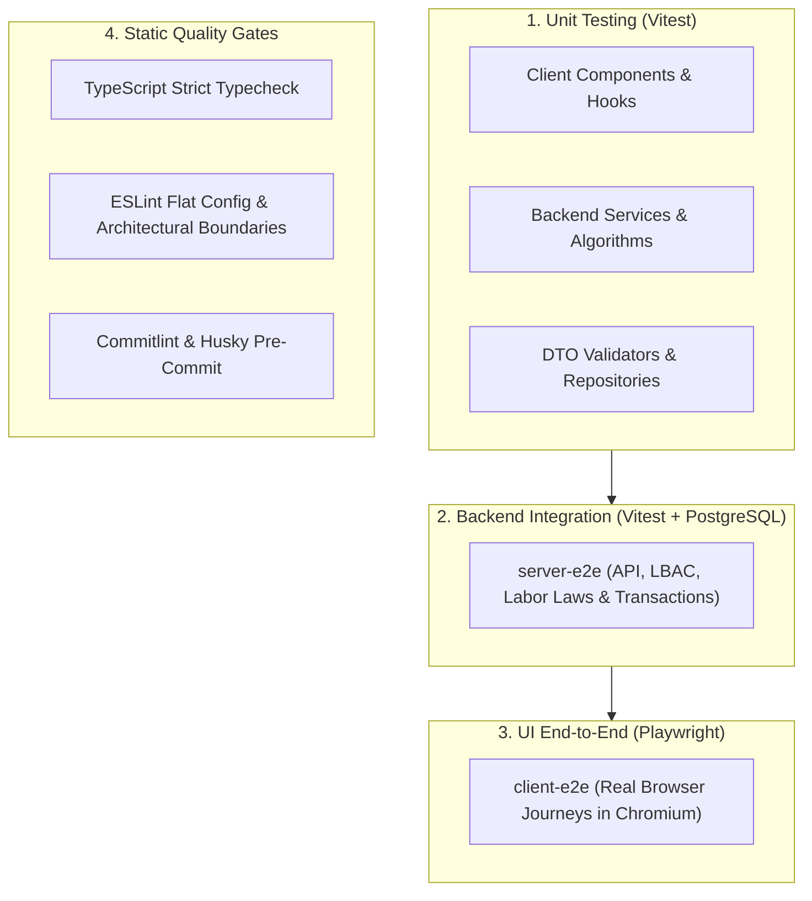
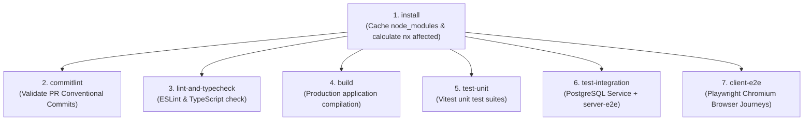

# Testing Strategy & Quality Gates

## 1. Overview & Quality Philosophy

ShiftSync employs a multi-tiered verification strategy designed to ensure absolute reliability across business logic, labor law compliance, database transactions, and end-user browser workflows.



---

## 2. The 3-Tier Test Pyramid

### 2.1 Tier 1: Unit Tests (Vitest)

Unit tests validate isolated functions, service calculations, and UI primitives with zero external network or database dependencies:

- **`apps/client`**: Verifies component rendering, custom hooks (`useShifts`, `useSwaps`), and role-based route redirects using `@testing-library/react` and Vitest.
- **`apps/server`**: Verifies `ComplianceService` calculations (rest gaps, daily caps, overtime formulas), authentication token generation, and business rules using Vitest and `unplugin-swc`.
- **`libs/shared/data-access`**: Verifies DTO runtime validation decorators (`class-validator`), cursor pagination math, and schema definitions.
- **Execution**:
  ```sh
  npx nx run-many -t test
  ```

### 2.2 Tier 2: Backend Integration & Labor Compliance (`apps/server-e2e`)

The server integration suite runs against an active **PostgreSQL 16** container, exercising actual SQL queries, transactional locks, and compliance algorithms:

- **`scheduling.spec.ts`**: Verifies double-booking prevention, 10-hour rest gap enforcement, and availability window validation.
- **`compliance.spec.ts`**: Tests 8h daily warning, 12h daily hard block, weekly 35h/40h overtime rules, and 7th consecutive day override documentation.
- **`cutoff-constraints.spec.ts`**: Validates the 48-hour schedule lock blocking manager edits, while verifying Admin emergency override capabilities.
- **`swap.spec.ts` & `edge-cases.spec.ts`**: Verifies the complete peer swap lifecycle (request $\rightarrow$ accept $\rightarrow$ approve), the 3-request pending cap, 24-hour drop expiration, and auto-cancellation upon shift mutation.
- **`manager-access.spec.ts`**: Enforces strict Location-Based Access Control (LBAC).
- **`analytics.spec.ts`**: Verifies calculation of the Fairness Index and premium shift distribution.
- **Execution**:
  ```sh
  npx nx e2e server-e2e
  ```

### 2.3 Tier 3: Browser UI Behavior-Driven Development (BDD) (`apps/client-e2e`)

Playwright drives real Chromium browser sessions compiled from business-readable Gherkin specifications (`playwright-bdd`), validating user journeys, labor law constraints, real-time WebSocket updates, and modal workflows:

- **BDD Living Specs**: 11 domain `.feature` suites in `apps/client-e2e/src/features/` with declarative `Rule:` blocks.
- **Reporting & Living Docs**: Produces code-free interactive Cucumber HTML reports at `dist/bdd-report/index.html` and synchronizes `docs/wiki/BDD-Living-Documentation.md` to GitHub Wiki.
- **Execution**:

  ```sh
  # Run full automated BDD acceptance suite
  npm run bdd:test

  # Interactive Playwright time-travel UI
  npm run bdd:ui

  # Generate or verify Markdown living documentation
  npm run bdd:docs
  npm run bdd:docs:check
  ```

---

## 3. Test Isolation & Surgical Cleanup

Running end-to-end tests against a live database requires strict test isolation to prevent test pollution without the performance penalty of a full database re-seed before every test:

### Surgical Cleanup (`clearDynamicData()`)

- In `apps/server-e2e/src/support/test-helpers.ts`, the `clearDynamicData()` helper surgically truncates dynamic transactional tables:
  ```sql
  TRUNCATE TABLE swap_requests, shift_assignments, shifts CASCADE;
  ```
- **Static Base Entities**: Base users, restaurant locations, skills, and user certifications are preserved, allowing individual tests to run in milliseconds.
- Individual test suites call `clearDynamicData()` inside `beforeEach` to start with a pristine scheduling state.

---

## 4. Static Quality Gates

ShiftSync enforces four layers of automated code quality checks before code can be merged:

### 4.1 Strict TypeScript Checks

Every project in the monorepo is compiled with strict TypeScript checking:

```sh
npm run typecheck
```

### 4.2 Architectural Boundary Enforcement (`eslint-import-rules.mjs`)

ESLint strictly enforces the 3-tier client architecture:

- Shared UI primitives and utilities (`components/`, `lib/`, `config/`) cannot import from domain features or app routes.
- Domain features cannot import from `app/`.
- Cross-feature dependencies must adhere to an approved directed acyclic graph.
- Unused imports and variables are blocked via `eslint-plugin-unused-imports`.

```sh
npx nx run-many -t lint
```

### 4.3 Git Hooks & Commitlint

- **Husky**: Pre-commit hooks run automated linting and formatting on staged files.
- **Commitlint**: Enforces the Conventional Commits specification on all commit messages (`feat: ...`, `fix: ...`, `docs: ...`), guaranteeing compatibility with automated semantic releases. Every line in the commit body is validated to not exceed **100 characters** (`body-max-line-length`).

---

## 5. Continuous Integration (CI) Pipeline

Every pull request targeting `develop` or `main` executes the GitHub Actions CI pipeline (`.github/workflows/ci.yml`):



### Selective E2E Gating with `nx affected`

To keep CI fast and efficient:

- The `install` job resolves base and head git SHAs and computes affected projects.
- `test-integration` and `client-e2e` only spin up container services and run tests if relevant code paths in their respective applications or dependencies have been modified.
